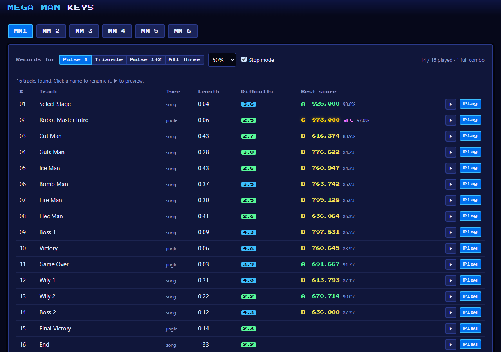

# Mega Man Keys

A keyboard trainer for the music of Mega Man 1–6. The original NES soundtrack plays while notes fall toward an on-screen piano, Rock Band style. Play along on a MIDI keyboard and you're scored on pitch and timing, with best scores and difficulty ratings for every song.



The music isn't recorded or transcribed. It's generated live by the games' own sound drivers, which run in a small NES sound emulator and are read straight from **your own copy** of *Mega Man Legacy Collection* (Steam). The repo contains no game data.

## Features

- **Every track, found automatically:** 16–34 per game, including stage themes, bosses, jingles and endings.
- **Play by hand:** right hand (both pulses, or one pulse alone as an easier version), left hand (the triangle), or both. Songs where channels swap roles get per-song exceptions, such as Needle Man's intro, where Pulse 1 plays the bass riff.
- **Practice tools:**
  - speed 25–100% without changing pitch;
  - **stop mode**, where the song waits at each note until you play it;
  - **sections:** drag across a timeline to practise one passage, once or on repeat;
  - seamless looping of the game's loop section;
  - octave shift, filtering of very short notes, and a quiet guide for your part.
- **Score runs:** scored out of 1,000,000 with S–D grades and full combos. A best score is kept for each song, chart, speed and stop-mode setting.
- **Difficulty ratings (1–10)** for each chart, based on note density, hand jumps and chords.
- **Suggested fingering:** finger numbers (1 = thumb … 5 = little finger) on every falling note, and on the keys you're about to play.
- **Accurate sync:** the audio clock accounts for output latency, and the results screen can calibrate your personal timing offset.
- **Track names** you assign are saved to the project. This repo ships names for almost every track in all six games.

## Requirements

- *Mega Man Legacy Collection* on Steam (the first collection, with MM1–6).
- [Node.js](https://nodejs.org/) 18 or newer.
- Chrome or Edge, for Web MIDI.
- A USB MIDI keyboard. Optional: the computer keyboard works too, with `A W S E D F T G Y H U J K O L P ;` playing C4 upward and `Z`/`X` shifting an octave.

## Getting started

```sh
git clone https://github.com/brentnewey/mm-music-trainer.git
cd mm-music-trainer
npm install
npm run dev
```

Open the printed URL (usually http://localhost:5173) in Chrome or Edge and allow MIDI access.

The dev server serves the game executable from the default Steam location, `C:\Program Files (x86)\Steam\steamapps\common\Suzy\Proteus.exe`. If yours is elsewhere, set `MMLC_EXE` to its full path before `npm run dev`, or choose the file in the page when asked. Only the six sound drivers (~130 KB) are extracted, and they're cached in the browser.

> If `npm install` skips Rollup's native module on Windows (an npm config with `os=linux` causes this), run `npm install --os=win32 --cpu=x64`.

## Playing

Pick a game, preview a track with ▶, then click **Play**.

### Practice

| Option | What it does |
|---|---|
| Your part | Right hand, Pulse 1 only, Pulse 2 only, Left hand, or Both hands, with each part's notes, range and difficulty |
| Section | Drag across the timeline of your part's notes to practise one passage. Edges snap to notes; drag an edge to adjust it or the middle to move it. *Whole song* clears it. The section is remembered per song, and the count-in plays the music just before it |
| Speed | 25–100% (score runs: 50–100%). The audio is re-rendered, so pitch doesn't change |
| Notes | Every note / Normal / Simplified / Long notes only (drops grace notes and arpeggio blips) |
| Your part in the music | Muted, quiet guide, or full |
| Loop | With a section, the section repeats, and the music leading into it replays with a 3-2-1 countdown before each pass (silence, for a section at the very start). Otherwise the intro plays once, then the loop section repeats as in the game. Shows per-pass accuracy; Esc → *Finish & see results* to stop |
| Stop mode | The song stops before each note until you play it |
| Octave shift / any octave | Fits melodies onto smaller keyboards |
| Show suggested fingering | Finger numbers on notes and upcoming keys (on by default) |
| Latency offset | Set from the results screen's timing calibration |

### Score runs

Switch the dialog to **Score run** to play for a record.

- **Parts:** Right hand, Pulse 1 only, Pulse 2 only, Left hand, or Both hands.
- **Records:** one best per **song × part × speed × stop mode**.
- **Score (out of 1,000,000):** 90% comes from timing accuracy (Perfect 100 / Great 70 / Good 40 per note, minus half a note per wrong press) and 10% from max combo.
- **Grades:** S ≥ 95%, A ≥ 90%, B ≥ 80%, C ≥ 70%, otherwise D. Every note hit with no wrong presses is a ★ full combo.
- **Fixed rules:** Normal notes, exact octaves and no loop, so records stay comparable.
- **Stop mode:** timing isn't judged, so the score reflects correct notes and wrong presses.

The bar above the song list chooses which part, speed and stop mode the list shows records and difficulty for, and score runs start from that selection. Tracks without notes for the selected part are hidden.

### Difficulty

Ratings come from the exact notes a score run uses, at the selected speed.
- **Cost per press:** every press costs 1, and a chord adds 0.5 per extra key. Repeating one of the hand's last two presses (a repeated note, or rocking between two keys) costs 0.65.
- **Reach:** a hand covers an octave without moving. A press within an octave of the hand's last few presses costs at most a small stretch, so an octave-bouncing bass (thumb and little finger) is cheap.
- **Jumps:** a press out of reach costs 0.6 per octave moved from the previous press, up to twice that when there's less than ¼ s to move.
- **Both hands at once:** adds 0.25.
- **Note variety:** each 4-second window counts in full when it uses 6 or more different notes. Fewer notes count less, down to 55% for a single repeated note. A note and its octave count as one.
- **Combining:** the cost per second is measured over 4-second windows, blending the busiest stretches (60%) with the average (40%).

Hover a rating to see presses per second, average jump size, chord share and note variety. At full speed, a typical song rates about 6 for Right hand, 4 for Pulse 1 only, 4.5 for Pulse 2 only, 4 for Left hand, and 7 for Both hands.

### Which hand plays what

The right hand plays both pulses (melody and harmony) and the left hand plays the triangle (bass). Every note of those channels is in the part, chords and all; nothing is picked out automatically. For an easier right hand, **Pulse 1 only** (usually the melody) and **Pulse 2 only** (usually the harmony) play the right hand's notes from one pulse.

Some songs swap roles, such as Needle Man's intro, where Pulse 1 plays the bass riff under the triangle's melody. Those songs are listed in `src/song/handOverrides.ts`. Each rule moves one channel to the other hand, optionally for a time range. `npx tsx tools/hands.ts <game> <id>` shows the hands over time.

In practice, the channels that mostly carry your part are the ones turned down by "Your part in the music".

### Suggested fingering

Fingering is predicted for each hand separately, using the hands chosen above. It uses dynamic programming (Viterbi) to find the cheapest finger sequence through the whole song under an ergonomic cost model, based on Parncutt et al. (1997), *An ergonomic model of keyboard fingering for melodic fragments*. The model charges for:
- stretches beyond comfortable spans for each pair of fingers;
- the weaker 4th and 5th fingers;
- the thumb or little finger on a black key next to white keys;
- 3 followed by 4;
- reusing a finger on a different key.

A thumb pass under fingers 2–4 counts as a hand shift, so scales come out with their textbook fingerings: C, G, D and F major, ascending and descending, in both hands. Chords get one finger per key in pitch order, and transitions across rests count for less because the hand can reposition. It's a suggestion, not a rule: NES melodies leap a lot, and an octave-plus leap is fingered as a hand jump.

### Your data

| File | Contents | In git |
|---|---|---|
| `track-names.json` | Names you give tracks (✎ rename) | Yes, so you can share names |
| `scores.json` | Your score-run records. Records from retired parts (the earlier channel charts, and the melody-only Right hand) stay in the file but aren't shown. The old Pulse 1 chart's records count for Pulse 1 only | No (gitignored) |

The dev server writes both files, and the browser keeps a copy, so they survive clearing browser data.

## How it works

1. **Extraction** (`src/rom/extract.ts`):
   - `Proteus.exe` keeps each game's ROM raw in its `.rdata` section, each followed by a descriptor and a label (`MegaMan2`, …).
   - It also keeps the jukebox's **NSF sound drivers** (`NSFMegaMan2`, …), the games' own sound engines repackaged for the collection.
   - `npm run extract` dumps the ROMs and drivers to `roms/` for inspection.
2. **Emulation** (`src/emu`):
   - A 6502 interpreter calls the driver's sound-request routine, then its per-frame update 60 times a second.
   - A register-level 2A03 APU model renders the audio: two pulses, triangle, noise and DMC, with the hardware's nonlinear mixer and filters.
3. **Discovery** (`src/song/discover.ts`): every sound ID is probed. Anything that uses at least two melodic channels for long enough is music, and IDs with identical output are merged.
4. **Analysis** (`src/song/analyze.ts`):
   - **Notes:** per-frame channel state becomes notes. Onsets come from note triggers, volume re-attacks and silences. Pitch is the most common rounded pitch, so vibrato and slides don't split notes.
   - **Loops:** found exactly from the APU register stream. MM3–6 use a fractional tempo, so for those a jitter-tolerant comparison of pitch features is used.
5. **Game** (`src/game`): audio and visuals share a clock derived from `AudioContext.getOutputTimestamp()`. MIDI timestamps are mapped onto it before judging (Perfect ±45 ms, Great ±90 ms, Good ±150 ms).

## Development

```sh
npm test                                   # unit tests (+ integration tests when roms/ has been extracted)
npm run build                              # type-check and production build
npm run extract                            # dump ROMs and sound drivers to roms/ (gitignored)
npx tsx tools/discover.ts                  # list discovered tracks for every game
npx tsx tools/render.ts mm2 1 out.wav      # print notes and render a track to WAV
npx tsx tools/difficulty.ts [speed]        # difficulty ratings for every chart of every song
npx tsx tools/fingering.ts mm2 0 both 40   # suggested fingering for a track and part
npx tsx tools/hands.ts mm3 1 both          # which hand plays each channel over time
npm run probe -- mm3 8000 806c 40          # disassemble a sound driver
```

## Known limitations

- **Track names:** the collection's track list is encrypted, so unnamed tracks show as "Track 07". Preview them and rename.
- **Inferred notes:** notes are inferred from sound-chip behaviour. Percussive pitch drops on the pulse or triangle channels can show up as short notes, and the Notes filter hides most of them.
- **Reduced speed:** the APU's hardware envelopes still run in real time. Capcom's drivers mostly use software envelopes, so this is rarely audible.
- **Platform:** the app runs from the Vite dev server, which provides the executable and the data files. It's built for Windows with Steam's default install location.

## Legal

This is a fan-made practice tool, not affiliated with or endorsed by Capcom. *Mega Man* is a trademark of Capcom. The repo contains no ROMs, music or other game data. You need your own purchased copy of the game.
